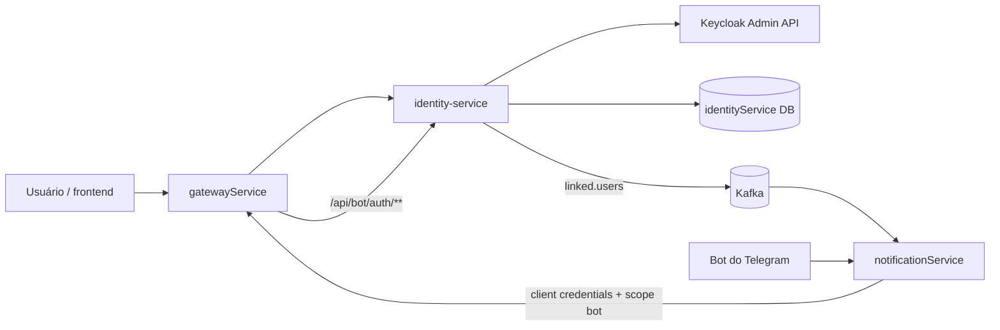
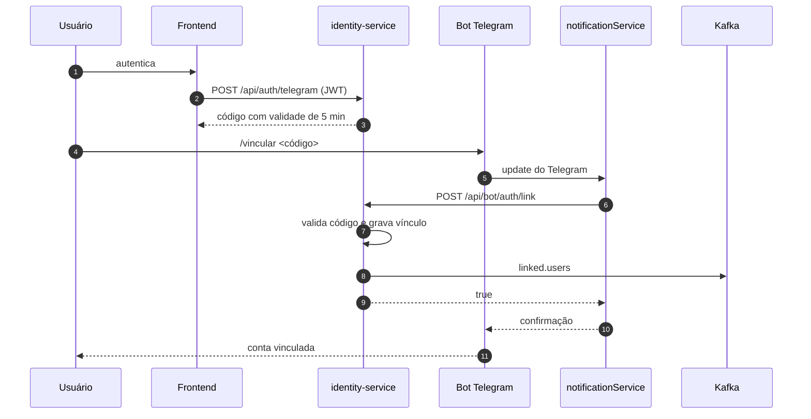

# identity-service

**Cadastro, autenticação e vínculo de contas do ChainTracker.** O serviço integra a aplicação ao Keycloak, cria usuários via Admin API, autentica credenciais e mantém o vínculo entre uma conta do ChainTracker e um chat do Telegram.

---

## Visão geral

O `identity-service` é a camada de identidade do ecossistema. Ele:

- cria usuários no Keycloak com username, e-mail e senha;
- autentica usuário/senha e devolve o token emitido pelo Keycloak;
- gera códigos temporários para vincular uma conta a um chat do Telegram;
- registra contas diretamente pelo bot do Telegram;
- mantém as tabelas de vínculo entre usuário e chat;
- publica o evento `linked.users` quando um vínculo é criado.

O serviço **não** armazena senhas. As credenciais e os tokens ficam no Keycloak; o banco local guarda apenas os vínculos com o Telegram.

---

## Stack

| Item | Tecnologia |
|---|---|
| Linguagem / runtime | Java 21 |
| Framework | Spring Boot 4.1.1 |
| Build | Maven (wrapper `mvnw`) |
| HTTP | Spring Web MVC |
| Persistência | Spring Data JPA + PostgreSQL |
| Keycloak | `keycloak-admin-client` 24.0.0 |
| Mensageria | Kafka (`spring-boot-starter-kafka`) |
| Segurança | Spring Security OAuth2 Resource Server (JWT) |
| Validação | Jakarta Bean Validation |
| Observabilidade | Actuator |
| Documentação | Springdoc OpenAPI (dependência presente no projeto) |
| Produtividade | Lombok |

---

## Posição no ecossistema



- O **gatewayService** encaminha `/api/auth/**` e `/api/bot/auth/**` para este serviço.
- O **notificationService** chama as rotas `/api/bot/auth/link` e `/api/bot/auth/register` com token de serviço e consome o evento `linked.users`.
- O Keycloak é a fonte de verdade de usuários, credenciais e tokens.

---

## Como funciona

### 1. Cadastro de usuário

`POST /api/auth/register` recebe `username`, `email` e `password` e executa:

1. monta um `UserRepresentation` com username, e-mail, conta habilitada e uma credencial de senha não temporária;
2. chama `POST /admin/realms/ChainTracker/users` no Keycloak;
3. em caso de `201 Created`, extrai o ID do usuário do header `Location` e o devolve como `String`;
4. em caso de `409 Conflict`, responde com o mesmo status e a mensagem “nome de usuário ou e-mail já cadastrado”;
5. em caso de `400 Bad Request`, responde com o mesmo status e “dados de cadastro inválidos”;
6. em qualquer outro status, responde `502 Bad Gateway`.

O `identity-service` usa o client `identity-service` do Keycloak, com service account e a role `manage-users` do `realm-management`, para executar a operação administrativa.

### 2. Login

`POST /api/auth/login` recebe `username` e `password` e executa:

1. cria um cliente Keycloak com `grantType=password`, `clientId=identity-service` e o client secret configurado;
2. solicita o token ao Keycloak;
3. devolve o `AccessTokenResponse` completo, contendo `access_token`, `expires_in`, `refresh_token`, `refresh_expires_in`, `token_type` e demais campos emitidos pelo Keycloak.

O token devolvido é o mesmo Bearer token aceito pelo gateway e pelos demais serviços.

### 3. Geração do código de vínculo

`POST /api/auth/telegram` é uma rota autenticada. O serviço:

1. lê o `sub` do JWT, que é o ID do usuário no Keycloak;
2. gera 4 bytes aleatórios com `SecureRandom`;
3. codifica em Base64 URL-safe sem padding, produzindo um código curto;
4. grava em `telegram_link_codes` com `created_at` e `expires_at = agora + 5 minutos`;
5. devolve `{ "code": "<codigo>" }`.

O código é de uso único e é apagado após um vínculo bem-sucedido.

### 4. Vínculo com o Telegram

O vínculo pode ser feito de duas formas:

#### Pelo site

1. o usuário autenticado chama `POST /api/auth/telegram` e recebe o código;
2. o usuário envia `/vincular <codigo>` ao bot do Telegram;
3. o `notificationService` chama `POST /api/bot/auth/link` no `identity-service`, passando `{ "code": "...", "chatId": ... }`;
4. o serviço valida o código, verifica se o usuário e o chat ainda não estão vinculados, grava `user_telegram_links` e apaga o código;
5. o serviço publica `linked.users` com `{ "userId": "...", "chatId": ... }`.



#### Pelo cadastro no Telegram

`POST /api/bot/auth/register` recebe `username`, `email`, `password` e `chatId`. O serviço:

1. valida os campos: `chatId` presente, username e e-mail não vazios, senha com pelo menos 8 caracteres;
2. verifica se o chat já está vinculado; se estiver, responde `409 Conflict`;
3. cria o usuário no Keycloak com o mesmo fluxo do cadastro web;
4. grava o vínculo em `user_telegram_links`;
5. publica `linked.users`;
6. se a gravação local falhar, remove o usuário recém-criado do Keycloak para manter as duas fontes consistentes.

### 5. Evento `linked.users`

| Item | Valor |
|---|---|
| Tópico | `linked.users` |
| Payload | `KafkaLinkedUser(userId, chatId)` |
| Serialização | JSON, sem headers de tipo (`spring.json.add.type.headers=false`) |
| Consumidor | `notificationService` |

O `notificationService` usa esse evento para manter a tabela local `linked_user`, que associa um chat do Telegram ao UUID do usuário no Keycloak.

---

## Modelo de dados

As tabelas são criadas e atualizadas pelo Hibernate (`spring.jpa.hibernate.ddl-auto=update`). O arquivo `src/main/java/ChainTracker/identity_service/migrationsAserFeitas.sql` documenta o schema de referência.

### Tabela `user_telegram_links`

| Coluna | Tipo | Observação |
|---|---|---|
| `user_id` | `varchar(36)` | chave primária; UUID do usuário no Keycloak (`sub`) |
| `telegram_chat_id` | `bigint` | único; ID do chat no Telegram |
| `linked_at` | `timestamp` | data/hora do vínculo |

Regras:

- cada usuário possui no máximo um vínculo;
- cada chat aponta para no máximo um usuário.

### Tabela `telegram_link_codes`

| Coluna | Tipo | Observação |
|---|---|---|
| `id` | `bigserial` | chave primária |
| `user_id` | `varchar(36)` | UUID do usuário no Keycloak |
| `code` | `varchar(10)` | código curto gerado |
| `expires_at` | `timestamp` | validade de 5 minutos |
| `created_at` | `timestamp` | data/hora de criação |

O SQL de referência também cria o índice `idx_telegram_code` para acelerar a busca por código.

> No ambiente completo, o banco `identityService` é compartilhado com o Keycloak: é nele que o Keycloak persiste o realm, usuários, clients e sessões.

---

## API HTTP

A porta interna do serviço é **8080**. No stack completo, ele é exposto na porta **3002** do host.

### Rotas de usuário

| Método | Caminho | Autenticação | Descrição |
|---|---|---|---|
| `POST` | `/api/auth/register` | pública | cria usuário no Keycloak |
| `POST` | `/api/auth/login` | pública | autentica e devolve o token |
| `POST` | `/api/auth/telegram` | JWT | gera código de vínculo |
| `POST` | `/api/auth/link` | JWT | vincula usuário a um chat usando o código |

### Rotas do bot

| Método | Caminho | Autenticação | Descrição |
|---|---|---|---|
| `POST` | `/api/bot/auth/link` | `SCOPE_bot` | vincula chat a uma conta existente |
| `POST` | `/api/bot/auth/register` | `SCOPE_bot` | cria conta e vínculo a partir do Telegram |

### Exemplos

#### Cadastro

```bash
curl -X POST http://localhost:3002/api/auth/register \
  -H "Content-Type: application/json" \
  -d '{
    "username": "maria",
    "email": "maria@example.com",
    "password": "senha-forte"
  }'
```

Resposta: o ID do usuário no Keycloak, como string.

#### Login

```bash
curl -X POST http://localhost:3002/api/auth/login \
  -H "Content-Type: application/json" \
  -d '{
    "username": "maria",
    "password": "senha-forte"
  }'
```

Resposta: `AccessTokenResponse` do Keycloak.

#### Geração de código de vínculo

```bash
curl -X POST http://localhost:3002/api/auth/telegram \
  -H "Authorization: Bearer <access_token>"
```

```json
{
  "code": "Ab3xY9"
}
```

#### Vínculo pelo bot

```bash
curl -X POST http://localhost:3002/api/bot/auth/link \
  -H "Authorization: Bearer <token_de_servico>" \
  -H "Content-Type: application/json" \
  -d '{
    "code": "Ab3xY9",
    "chatId": 123456789
  }'
```

Resposta: `true` em caso de sucesso.

#### Cadastro pelo bot

```bash
curl -X POST http://localhost:3002/api/bot/auth/register \
  -H "Authorization: Bearer <token_de_servico>" \
  -H "Content-Type: application/json" \
  -d '{
    "username": "maria",
    "email": "maria@example.com",
    "password": "senha-forte",
    "chatId": 123456789
  }'
```

Resposta: `true` em caso de sucesso.

---

## Documentação OpenAPI

O serviço gera a especificação OpenAPI a partir dos controllers e publica o Swagger UI.

| Recurso | URL |
|---|---|
| Swagger UI direto | `http://localhost:3002/swagger-ui.html` |
| Especificação JSON | `http://localhost:3002/v3/api-docs` |
| Swagger UI pelo gateway | `http://localhost:3006/swagger-ui.html` (selecione `identity-service`) |

Na interface, use o botão **Authorize** com um Bearer token do Keycloak. As rotas `/api/bot/auth/**` exigem um token de serviço com o escopo `bot`.

---

## Segurança

- O serviço é um **resource server**: valida o JWT do realm `ChainTracker` com `issuer-uri` e `jwk-set-uri` do Keycloak.
- `POST /api/auth/register` e `POST /api/auth/login` são públicos.
- `/api/bot/**` exige a authority `SCOPE_bot`.
- As demais rotas exigem autenticação.
- A criação de usuários no Keycloak usa um **service account** com a role `manage-users` do client `realm-management`.
- O login usa o grant `password` do Keycloak com o client confidencial `identity-service`.

---

## Configuração

Arquivo principal: `src/main/resources/application.yaml`.

| Propriedade | Valor padrão | Observação |
|---|---|---|
| `server.port` | `8080` | porta interna |
| `spring.datasource.url` | `jdbc:postgresql://identity-service-db:5432/identityService` | banco do serviço e do Keycloak |
| `spring.datasource.username` | `user` | usuário do banco |
| `spring.datasource.password` | `postgres` | senha do banco |
| `spring.jpa.hibernate.ddl-auto` | `update` | schema gerenciado pelo Hibernate |
| `spring.security.oauth2.resourceserver.jwt.issuer-uri` | `http://keycloak:8080/realms/ChainTracker` | emissor do token |
| `spring.security.oauth2.resourceserver.jwt.jwk-set-uri` | `http://keycloak:8080/realms/ChainTracker/protocol/openid-connect/certs` | chaves públicas |
| `spring.kafka.producer.bootstrap-servers` | `kafka:9092` | broker |
| `spring.kafka.producer.value-serializer` | `JsonSerializer` | payload JSON |
| `spring.kafka.producer.properties.spring.json.add.type.headers` | `false` | payload sem metadados de tipo |
| `security.client-secret` | — | variável `KEYCLOAK_SECRET` |
| `keycloak.url` | `http://keycloak:8080` | URL do Keycloak |

Variável de ambiente usada no compose:

```bash
KEYCLOAK_SECRET=...
```

### Requisitos no Keycloak

O realm `ChainTracker` precisa ter:

- client confidencial `identity-service`, com **service account** habilitado e **direct access grants** habilitado;
- role `manage-users` do client `realm-management` atribuída ao service account do `identity-service`;
- client secret igual ao valor de `KEYCLOAK_SECRET`.

---

## Como executar

### Localmente

Pré-requisitos: Java 21, PostgreSQL e um Keycloak com o realm `ChainTracker`.

```bash
export KEYCLOAK_SECRET=...
./mvnw spring-boot:run
```

O serviço sobe em `http://localhost:8080`.

### Com Docker

```bash
./mvnw clean package -DskipTests

docker build -t identity-service .
docker run --rm -p 3002:8080 \
  -e KEYCLOAK_SECRET=... \
  identity-service
```

### No stack completo

No repositório `ChainTracker`, o serviço é construído a partir de `./identity-service`, exposto em `3002:8080` e configurado com a variável `KEYCLOAK_SECRET`.

---

## Estrutura do projeto

```text
identity-service/
├── src/main/java/ChainTracker/identity_service/
│   ├── configuration/   # Keycloak Admin Client e Spring Security
│   ├── controller/      # rotas de usuário e do bot
│   ├── dto/             # contratos de entrada e saída
│   ├── entity/          # entidades JPA de vínculo
│   ├── repository/      # repositórios Spring Data
│   ├── service/         # regras de cadastro, login e vínculo
│   └── IdentityServiceApplication.java
├── src/main/resources/
│   └── application.yaml
├── src/test/java/ChainTracker/identity_service/
│   └── IdentityServiceApplicationTests.java
├── Dockerfile
├── pom.xml
└── mvnw / mvnw.cmd
```

---

## Observabilidade

- `spring-boot-starter-actuator` expõe os endpoints de health e métricas.
- O serviço registra no console os erros retornados pelo Keycloak durante o login e as falhas de publicação no Kafka.
